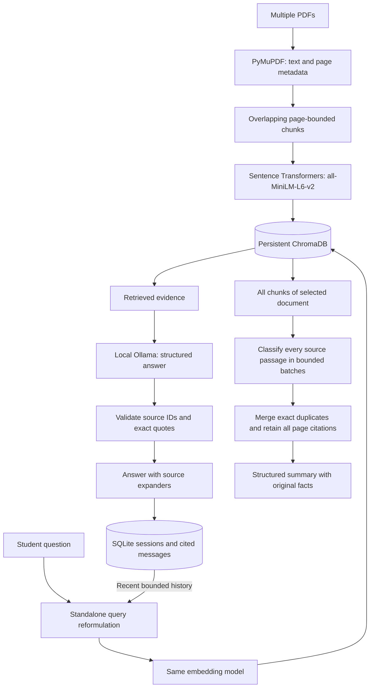

# CampusRAG

**Session-Aware University AI Assistant**

CampusRAG helps students navigate university PDFs through grounded answers, page citations, persistent conversations, and document summaries. This independent portfolio project runs locally without paid APIs.

Students often need to cross-reference regulations, attendance rules, and examination instructions. CampusRAG makes those documents searchable while preserving the evidence behind an answer and the context behind a follow-up question.

## Features

- **Multiple PDFs:** page-aware extraction, overlapping chunks, SHA-256 duplicate detection, and persistent indexing.
- **Document-grounded Q&A:** semantic retrieval followed by local Ollama generation; insufficient evidence produces an explicit abstention.
- **Session-aware memory:** independent SQLite conversations survive restarts; only a bounded recent window reformulates follow-ups.
- **Traceable citations:** real PDF filenames, one-based page numbers, and validated supporting quotations, saved with answers.
- **Whole-document summaries:** every text chunk is covered by source-backed factual bullets grouped under relevant headings, preserving numbers and requirements.
- **Streamlit interface:** upload status, document library, conversation switching/deletion, source expanders, and summary controls.

The three included PDFs describe **fictional Meridian Example University** policies. They are demonstration material, **not official DTU or any other university policies**.

## Technology

Python 3.11 · Streamlit · LangChain Core and current integration packages · ChromaDB · Sentence Transformers (`all-MiniLM-L6-v2`, CPU) · Ollama (`llama3.2:3b`) · PyMuPDF · SQLite · python-dotenv · pytest. ReportLab reproduces the sample PDFs.

The app uses `langchain_core`, `langchain_chroma`, `langchain_ollama`, and `langchain_text_splitters` directly. It does not use deprecated conversation chains or require the umbrella `langchain` package.

## Architecture



**Ingestion:** PDF bytes → SHA-256 → page text → recursive character splitting (800 characters, 120 overlap by default) → normalized MiniLM embeddings → Chroma chunks. Metadata preserves filename, page, document hash, and deterministic chunk ID. A small Chroma catalog commits only completed imports; failed/interrupted imports are hidden and retryable. Repeated uploads skip embedding. Original PDF files are not retained for user uploads; extracted text and metadata persist.

**RAG:** the same embedding adapter indexes documents and embeds standalone questions. Chroma retrieves a configurable top-k. Ollama receives only retrieved text as factual evidence. It returns structured claims and supporting quotes. The app rejects unknown source IDs or quotations absent from the retrieved chunk and creates citation labels itself. Similarity rank is never treated as proof of support.

The response schema is supplied in both the model instructions and Ollama's constrained decoder, following [Ollama's structured-output guidance](https://docs.ollama.com/capabilities/structured-outputs). Retrieved text is divided into numbered passages. The model selects passage IDs before writing claims and makes its answerability decision last. Python attaches each passage's exact text and original PDF/page metadata, then checks it against the retrieved chunk. This prevents model transcription or source-assignment mistakes from fabricating quotations. A false answerability flag rejects the answer. Unknown IDs receive at most one corrective attempt; an invalid regenerated answer is rejected in full.

**Memory:** SQLite stores sessions and atomic user/assistant turns, including citation JSON. The newest eight messages, capped at 3,500 UTF-8 content bytes, are used only to resolve references in a follow-up. Answers receive the standalone question and retrieved evidence, not factual claims from chat history. Deleting a session cascades to its messages. All sessions share the document library; conversations remain independent.

Only questions with contextual references (such as "this" or "what about") are reformulated. Explicit new questions bypass rewriting so a new topic cannot be overwritten by the previous conversation.

**Summaries:** the local model classifies every source passage under overview, main points, rules, or dates/requirements. Python renders the exact source facts and citations, preserving times, amounts, units, and nonnumeric requirements. Coverage validation rejects missing, duplicate, or invented passage IDs; only exact duplicate text is merged, retaining citations to every source page. Empty sections are omitted. Long summaries can contain more factual bullets because distinct facts are never discarded to satisfy a note-count limit. The default processing cap remains 100 chunks; oversized documents fail explicitly without a partial summary. Summaries are temporary UI results; chat history and the document index persist.

## Windows setup

Install Python **3.11** and [Ollama for Windows](https://ollama.com/download/windows). Allow several GB of free disk space for dependencies and model weights. CPU inference works; available RAM and hardware determine response time. The first embedding model download also needs internet access. Models run locally after download.

In PowerShell from the existing project folder:

```powershell
cd D:\CampusRAG
python -m venv .venv
.\.venv\Scripts\Activate.ps1
python -m pip install -r requirements.txt
Copy-Item .env.example .env
ollama pull llama3.2:3b
python -m streamlit run app.py
```

If `.venv` already exists, skip its creation. If `.env` already exists, retain your existing configuration. If PowerShell blocks activation, use the virtual environment interpreter directly:

```powershell
.\.venv\Scripts\python.exe -m pip install -r requirements.txt
.\.venv\Scripts\python.exe -m streamlit run app.py
```

The app opens at **http://localhost:8501**. The Ollama desktop app normally runs its server; otherwise run `ollama serve` in a separate terminal. Use `ollama list` to confirm the exact configured model tag is downloaded. After changing `.env`, restart Streamlit because services are cached between UI reruns.

1. Click **Load fictional sample PDFs**, or upload your own text-based PDFs and click **Process documents**.
2. Ask a question and expand **Supporting sources**.
3. Ask a follow-up, create another chat, then switch back.
4. Select a PDF and click **Generate summary**; open the Document summary view.
5. Restart the app to check that the document library and chats remain available.

## Configuration

Copy `.env.example` to `.env`; environment variables override that file. Relative paths resolve against the project directory.

| Variable | Default | Purpose |
|---|---|---|
| `OLLAMA_MODEL` | `llama3.2:3b` | Local model tag |
| `OLLAMA_BASE_URL` | `http://localhost:11434` | Ollama server |
| `CHROMA_DIR` | `data/chroma` | Persistent document index |
| `SQLITE_PATH` | `data/campusrag.db` | Persistent conversations |
| `EMBEDDING_MODEL` | `sentence-transformers/all-MiniLM-L6-v2` | Same model for indexing and retrieval |
| `CHUNK_SIZE` / `CHUNK_OVERLAP` | `800` / `120` | Characters, split separately per page |
| `RETRIEVAL_TOP_K` | `5` | Retrieved chunks (1–12) |
| `LLM_TEMPERATURE` | `0` | Generation temperature |
| `LLM_CONTEXT_TOKENS` | `8192` | Ollama context window (minimum 8192) |
| `LLM_TIMEOUT_SECONDS` | `180` | Inference timeout |
| `MEMORY_MESSAGES` | `8` | Maximum messages used for reformulation |
| `MAX_SUMMARY_CHUNKS` | `100` | Explicit whole-document summary cap |

Embedding caches live in `.cache/`. Changing the embedding model requires a fresh `CHROMA_DIR` or restoring the original model. Changing chunk settings affects new imports; identical PDFs remain deduplicated. To rebuild all documents, stop the app, choose a new `CHROMA_DIR`, and reprocess the PDFs.

## Example questions

- What is the minimum attendance requirement?
- Does this also apply to M.Tech students?
- What documents must I carry into the examination room?
- What is the deadline for requesting re-evaluation?
- What is the normal credit load for B.Tech students?
- How much does a hostel room cost? *(Not specified: the assistant should abstain.)*

The separate summary controls summarize a selected PDF in full; chat answers use top-k evidence and should not be used as a substitute for a complete document summary.

## Project layout

```text
app.py                     Streamlit interface
config.py                  Validated environment settings
rag/document_processor.py  PDF extraction and page-aware splitting
rag/vector_store.py        Embeddings, persistence, and retrieval
rag/rag_pipeline.py        Query rewriting, answers, citation validation
database/session_store.py  SQLite sessions and cited chat history
services/chat_service.py   Conversation orchestration
services/llm.py            Typed Ollama boundary and status checks
services/summarizer.py     Chunk-based, grounded summaries
scripts/                   Reproducible fictional PDF generation
data/sample_documents/     Three fictional two-page policies
tests/                     Focused storage, retrieval, LLM, and UI tests
```

## Testing

```powershell
.\.venv\Scripts\python.exe -m pytest -q
.\.venv\Scripts\python.exe -m pip check
.\.venv\Scripts\python.exe -m streamlit run app.py --server.headless true
```

The automated suite uses real PyMuPDF, temporary SQLite/Chroma storage, deterministic test embeddings, and mocked Ollama responses. It checks extraction/errors, chunking/metadata, duplicates and persistence, failed-import recovery, session isolation/deletion, follow-up routing, unsupported answers, citation validation, complete summary coverage, and Streamlit controls. Test embeddings are used only in tests; the application uses MiniLM.

For a real-model check, start Ollama, pull the configured model, load the sample PDFs, and try the example questions and summary controls. Verify quotes and page numbers against the PDFs. Mocked tests cannot establish real-model answer quality.

Opt-in automated integration checks use temporary storage inside `tmp/`:

```powershell
$env:RUN_EMBEDDING_TESTS = "1"
python -m pytest tests/test_local_models.py -q
$env:RUN_OLLAMA_TESTS = "1"
python -m pytest tests/test_local_models.py -q
```

The first command can download the free MiniLM model. The Ollama test skips if the configured server/model is unavailable; otherwise it checks a direct answer, a contextual follow-up, an unsupported question, and a whole-document summary.

**Local validation (27 October 2026):** all 60 tests passed with real MiniLM and `llama3.2:3b` integration enabled. Coverage includes the attendance and library conversations, unsupported questions, persistent cited history, all five library facts in the rendered summary, multi-page dates and requirements, summaries beyond 16 distinct notes, complete passage assignment, and page-citation provenance. Streamlit control tests and dependency checks passed. The existing UI, RAG pipeline, document index, and chat data were preserved.

Recreate the sample PDFs with `python scripts/create_sample_documents.py`.

## Screenshots

The interface includes an upload/library sidebar, chat sessions, answer source expanders, and a structured summary view. Add screenshots of your own local demonstration here after loading documents and running Ollama; do not present mocked responses as real-model results.

## Limitations and troubleshooting

- **Model reliability:** prompts, structured output, and exact-quote checks reduce hallucinations; quote existence does not prove semantic entailment. A small model can still misinterpret evidence or rewrite a follow-up incorrectly. Verify consequential rules against the original document.
- **PDF text only:** no OCR, images, table reconstruction, or scanned-page interpretation. Blank/unreadable pages are disclosed and excluded. Limits: 20 MB, 500 pages, 10,000 chunks per PDF.
- **Retrieval:** simple dense top-k retrieval may miss evidence or cross-document exceptions. Long or multilingual chunks can exceed MiniLM's token limit. Defaults suit short English policy passages.
- **Summaries:** extractive factual bullets favor preserving original details over aggressive paraphrasing. Large PDFs can produce longer summaries and take many model calls. Coverage failures, context overflow, and documents above the configured chunk cap fail with a clear error.
- **Local single-user use:** no authentication or multi-user isolation. Conversations are separate; indexed documents are shared. Run one Streamlit process per storage directory and keep the local server private.
- **Ollama unavailable/model missing:** install/start Ollama, run `ollama pull llama3.2:3b`, then click Refresh model status. Indexing and session controls work without Ollama.
- **Embedding download/index error:** check connectivity and free disk space, then retry; completed documents are not re-embedded. Diagnostics are in `data/campusrag.log` (generated and ignored by Git).
- **Unexpected insufficient-evidence answer:** the log distinguishes empty retrieval/context, model abstention, and rejected source IDs/quotes. Check the actual retrieved pages before changing retrieval settings. Restart Streamlit after code changes to reload cached services; existing documents and conversations remain available.
- **Slow inference/timeouts:** use a model suited to your hardware or increase `LLM_TIMEOUT_SECONDS`. Keep the configured context within the chosen model's supported window.

Integration references: [LangChain Chroma](https://docs.langchain.com/oss/python/integrations/vectorstores/chroma) and [LangChain ChatOllama](https://docs.langchain.com/oss/python/integrations/chat/ollama).
